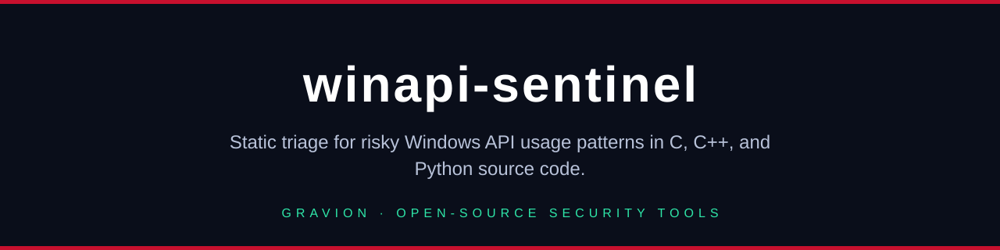

<p align="center"></p>

# WinAPI Sentinel

[](https://github.com/gravion-ux/winapi-sentinel/actions/workflows/ci.yml) [](LICENSE)

**Static triage for risky Windows API usage patterns in C, C++, and Python source code.**

## Usage

```bash
pip install -e .
winapi-sentinel scan examples/inject_sample.c
winapi-sentinel scan path/to/file.c --json
```

Exit code is non-zero when a high or critical finding is present, so the
tool drops cleanly into CI.

## What it detects

- Remote-injection primitives and the full injection chain
- Hook and key-state polling patterns used by keyloggers
- Shell execution, registry persistence writes, and cross-process opens

## License

MIT
